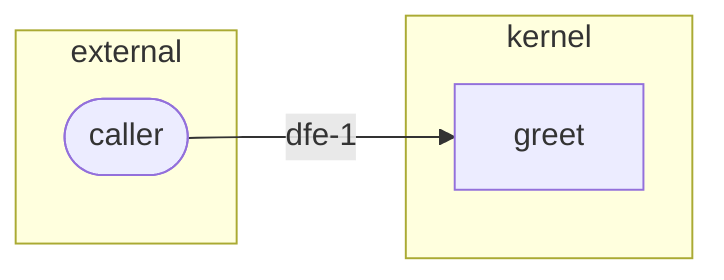

# Demo Greeting — Threat Model

## Narrative
The only external input is the `name` parameter. The function performs no I/O, opens no sockets, reads no files. Trust boundary is between the caller and the function body.

## STRIDE coverage
- `dfe-1` (name-input): T (tampering). A caller may pass a maliciously-crafted string. Mitigation: precondition rejects empty strings; output is purely deterministic so no injection sink exists.

## Mitigations
- Precondition validates non-empty.
- Pure function — no eval, no system calls, no logging that could re-serialize attacker input unsafely.

## Domain checklist (REQ-333)

| Domain | Answer |
|---|---|
| Authentication | N/A because the function has no identity of its own; it is called in-process |
| Authorization | N/A because there is no access-control decision to make |
| Session | N/A because there is no session; the call is a single in-process function invocation |
| PII and retention | dfe-1: the name is used only to build the returned string; nothing stores or logs it |
| Payments | N/A because nothing here handles money |
| Secrets at rest | N/A because the function holds no secret |
| Sensitive logging | dfe-1: greet performs no logging |
| Rate limiting | N/A because there is no exposed endpoint to rate-limit |
| Third-party integrations | N/A because the function calls nothing external |
| Update channel for apps | N/A because this is a pure library function, not a distributed app |

