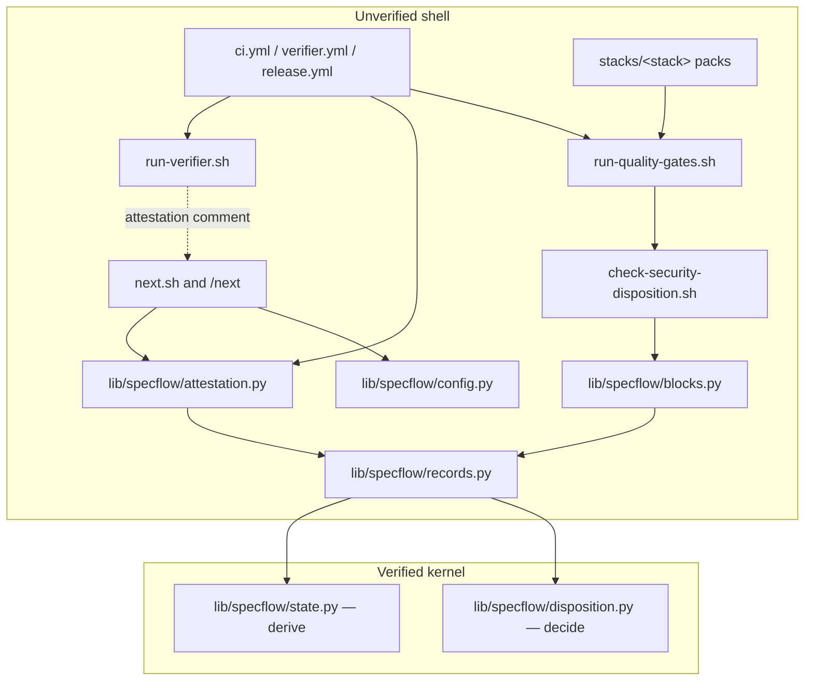
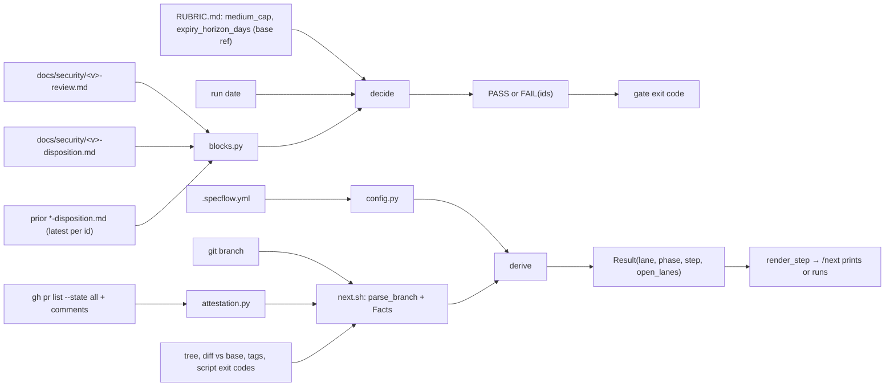

# Factory v3.2 — Architecture Overview

## Verified kernel boundary

Two pure Python decision functions form the verified kernel. Everything else is unverified shell: it gathers inputs from files, `git` and `gh`, hands the kernel plain values, and prints the kernel's answer.

| Kernel module | Function | REQ | Proof |
|---|---|---|---|
| `scripts/lib/specflow/disposition.py` | `decide(review, disposition, prior, medium_cap, expiry_horizon_days, run_date) -> Verdict` (joins entries to review severity by id) | REQ-322 | `verification/factory_v3_2/disposition.dfy` |
| `scripts/lib/specflow/state.py` | `derive(branch, branch_pr, open_lane_prs, facts, path, solo) -> Result` (records in `records.py`; `PR.mine`, `Facts.ship_phases_merged`, P5 R5–R6) | REQ-341 | `verification/factory_v3_2/state.dfy` |

Both functions take values and return values, perform no I/O, and read no environment. The boundary is drawn here because these two functions are where a wrong answer silently changes what ships: one decides whether a release may proceed with its security findings, the other decides what the user is told to do next and whether `/next` may emit a merge command (the REQ-385 property is a named proof obligation, ADR-003).

Outside the kernel, on purpose:
- **Parsers and scoring** — `scripts/lib/specflow/cvss4.py` (CVSS v4.0 base score from a vector via FIRST's vendored macro-vector table, with conformance fixtures from the FIRST calculator; size M on its own), `scripts/lib/specflow/blocks.py` (YAML-block parser for review/disposition files, stdlib), `scripts/lib/specflow/config.py` (flat `.specflow.yml`), and the frontmatter/list parsers P0 established, lifted in P3 into `scripts/lib/specflow/frontmatter.py`, which `check-traceability.sh`, `analyze-adr-plan-linkage.sh`, `architecture.py` and `check-covers.sh` import (`config.py` and `attestation.py` keep their own reader, materialised alone from the base ref). They turn text into records and are fixture-tested.
- **Attestation classifier** — `scripts/lib/specflow/attestation.py` reduces PR comments to `none | approve | request_changes | waiver` by the rules of REQ-311/382 and is the single module both the CI check and `next.sh` use, through `pr_attestation`. It is fixture-tested, not proved.
- **Fact collection** — `next.sh` computes the `Facts` record (artifact presence, `## Build N` sections, source diff vs base, analyze and gate exit codes, tags) so the kernel decides order and precedence, never whether an artifact is complete.
- **Every other v3.2 script** (`check-architecture.sh`, `check-test-first.sh`, `check-covers.sh`): one-clause filters over files, exercised by fixtures (REQ-320, 321, 323). Their failure is loud only when their inputs exist; `check-test-first.sh` must error, not pass, when its source-root globs match nothing (REQ-321 as amended).
- **P6's release path** (REQ-350, REQ-383, REQ-384, REQ-390): `release.yml` publishes Releases and images with write permissions (`contents: write`, `packages: write`) after re-checking the tag; `release-tag.sh` signs and pushes the tag; `signers.py` verifies a tag against the anchored `.github/allowed_signers`; `release_manifest.py` assembles and compares the manifest; `release-smoke.sh` runs the built artifact. None is a one-clause filter over files — each acts on the world or decides what is published — and each is exercised by fixtures, scratch repositories and stub tools; no kernel module changed (`state.py`, `disposition.py` and their Dafny models are untouched; PR #56 verifier run 1, finding 6).
- **`verify-release.sh`** (REQ-324): a filter over files, and since P6 Build 2 more — in CI it runs the stack's release hook, `scripts/release-<stack>.sh` (the stack read at the base ref), on the PR head's tree to build the reproducible subset it compares the notes' Artifacts table with (P6 R26; it never reads `dist/` there); that hook and `release_manifest.py` are PR-head gate code (dfe-14), exercised by fixtures and scratch repositories.

This is the same three-layer shape the demo uses (`verification/README.md`): proof of the model, tests of the parsers and plumbing, and the wrapper as the only place that touches the world. The gap between the Dafny model and the Python twin is held closed by fixtures that mirror the model: one per rule and per state-table row, a permutation fixture (shuffled inputs give the same verdict), a "lows only" fixture, and a `derive` truth table over every `Branch` constructor × attestation × path.

## Interfaces the plans implement

`scripts/lib/specflow/records.py` (frozen dataclasses and enums; names are shared with the Dafny models):

```
Severity = critical | high | medium | low          Status = open | fixed | accepted | deferred
Rule = set_equality | severe_not_fixed | medium_cap | carry_forward | expiry_window
Finding(id: str, severity: Severity, cvss_vector: str)               # from the review; severity derived from the vector
Entry(id: str, status: Status, owner: str, expiry: date | None, rationale: str, reclassified_by: str | None)  # from the disposition
PriorEntry(id: str, severity: Severity, status: Status, expiry: date | None, version: str)  # latest per id
Violation(id: str, rule: Rule)
Verdict(passed: bool, violations: tuple[Violation, ...])             # violations sorted by (id, rule)

Path = lanes | regulated
Branch = Main | Design(slug) | Build(slug, n) | BuildSec(id) | Ship(version) | Patch(slug) | PhaseSpec(slug) | PhaseArch(slug)
       | PhasePlan(slug) | Impl(n, name) | ImplSec(id) | PhaseValidate | PhaseSecurity | PhaseRelease | Unknown
Attestation = none | approve | request_changes | waiver
PR(number: int, open: bool, merged: bool, closed: bool, human_approved: bool, attestation: Attestation)
Facts(has_brainstorm, has_spec, spec_has_tagged_reqs, arch_complete, has_plan, build_sections: frozenset[int],
      analyze_ok, has_source_diff, gates_pass, has_security_docs, has_release_docs, signing_key_present, pr_state_known: bool,
      unbuilt: tuple[(slug, n), ...], untagged_ship: str | None, next_version: str | None)
Step = RunBrainstorm | RunSpecify | RunArchitecture | RunPlan | RunAnalyze | RunImplement(n | sec) | RunGates
     | RunSecurityReview | RunRelease | CreatePr | RunVerifier(pr) | RequestReview(pr) | Merge(pr) | Checkout(pr) | CheckoutMain
     | NewBranch(name) | AddressFindings | TagRelease(version) | ExplainUnknown
Result(lane: Lane, phase: Phase, step: Step, open_lanes: tuple[int, ...])
```

- `disposition.decide(...)` raises `ValueError` on a precondition violation (duplicate ids, missing owner/expiry, invalid vector, negative cap); the wrapper maps it to exit 2. FAIL is exit 1, PASS exit 0.
- `pipeline.parse_branch(name) -> Branch` is total (`Unknown` fallback; `build/<slug>-N` splits on the last `-`). `pipeline.render_step(step, ctx) -> str` produces the literal command text, including the full second-terminal instruction for `RunVerifier` and the `cd <repo>` path. `--json` prints `Result` as JSON. Both functions live in the wrapper, `scripts/lib/specflow/pipeline.py`, not in the kernel file.
- Dates cross the boundary as `datetime.date`; the Dafny model uses ordinals. Versions are compared as semver by the wrapper before reaching the kernel.

## Components



## Data flow



- **Disposition path:** the wrapper resolves the version under release (`--version`, else the `ship/<version>` branch, else the unique untagged version with security docs; ambiguity is an error; none is a printed skip), parses the current and prior blocks, reduces prior entries to the latest per id, reads the rubric values from the base ref in CI, checks that no review id was removed since the base, and calls `decide` with today's date. FAIL names ids; the gate runner exits non-zero.
- **State path:** the wrapper parses the branch, collects PRs and reduces their attestations, computes `Facts`, parses config, calls `derive`, renders the step. In the guided profile `/next` runs the step except `RunVerifier` (printed with the full instruction) and pauses at the enumerated confirmation points, including before `Merge` and before an unsigned `TagRelease`.

## Consequences recorded for later plans
- P3 created `records.py`, `blocks.py`, `cvss4.py` (with `cvss4_data.py`, vendored from FIRST's calculator), `disposition.py`, `disposition_gate.py` and `check-security-disposition.sh`, the Dafny model `verification/factory_v3_2/disposition.dfy`, and `schemas/security-disposition-template.md`, and migrated the demo disposition and review and the tauri pack's `0.0.0-skeleton` review and disposition (P4) to it.
- P2 created `attestation.py` (the CI check runs the base's copy); P5 extended it (`pr_attestation`, a `MEMBER` waiver's repository role, npm lockfile growth) and created `state.py`, its Dafny model `verification/factory_v3_2/state.dfy`, `pipeline.py`, `next.sh` and `/next`.
- P4 created `scripts/check-architecture.sh` (REQ-333 checklist and the ARCHITECTURE exit-gate shape). It checks a live spec once a plan names it or once its threat model or overview exists, so the gate bites at the regulated path's `phase/arch-<slug>` PR, before any plan; P3 scoped its `req_map` check to the `implements:` claims (REQ-320, REQ-394) and added `confirmed_by:` for the guided profile (REQ-389's check).
- P6 created `signers.py`, `release_manifest.py`, `release-tag.sh`, `release-template.sh`, `release-smoke.sh`, `release-publish.sh`, `release-build.yml` and `release.yml`, and extended `attestation.py` (`release-check`, through `pr_attestation`), `release_gate.py` and `disposition_gate.py` (`--at-tag`); no kernel module changed.
- The lane-to-phase mapping in `.claude/rules/review-gate.md` must exist before `--path lanes` is selectable (ADR-003 consequences).
