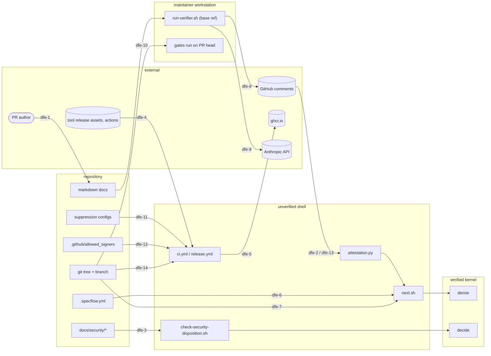

# Factory v3.2 — Threat Model

## Narrative

The factory is a pipeline of scripts that read repository files, PR metadata and tool output, and decide two things that matter: whether a release may proceed (REQ-322) and what the user should do next, including whether a merge may be emitted (REQ-341). Both decisions sit inside the verified kernel; every input to them crosses a trust boundary from something an outsider or a careless insider controls. The attacker of interest is a PR author with write access (or any account on a public repository) who wants a merge without review, a green release with open findings, or the maintainer's credentials. A second class is supply chain: a binary, package or action fetched by CI. A third is the maintainer's own workstation, where the verifier runs as an LLM with whatever the user's Claude configuration allows.

The "Delivered in" column names the plan that ships each mitigation. P2 (dfe-1, dfe-2, dfe-6, dfe-8, dfe-9), P3 (dfe-3), P4 (dfe-4 except `release.yml`, dfe-11, dfe-13 except the tag-time re-check) have shipped, and P5 (dfe-7, dfe-10) was delivered by P5, PRs #47 and #48, merged 2026-09-30, and P6 (dfe-4's `release.yml` elevation, dfe-12, dfe-13's tag-time re-check) was delivered by Builds 1–3 (PRs #53 and #54, and Build 3's PR); dfe-2's rule 1b and base binding and dfe-13's npm new-entry rule are P5's too (their rows read `P2, P5` and `P4, P5`); every other row is open until its plan merges.

## Elements

| id | Element | Boundary | Threats | Mitigations (REQ) | Delivered in |
|---|---|---|---|---|---|
| dfe-1 | PR-author markdown (specs, plans, any `.md` the verifier reads) | pr-author-to-verifier | **T** prompt injection alters findings or verdict; **I** injected instructions read host files (including via symlinks committed in the PR); **E** injected instructions try to run tools | verifier runs in a scratch worktree with project settings disabled, an empty MCP config, `mcp__*` and all non-read tools disallowed, reads denied outside the worktree, symlinks pointing outside the worktree refused; skill, constitution and prompt read from the base branch via `git show`; content declared data (REQ-313 as amended) | P2 |
| dfe-2 | PR comments (attestation markers, waivers) | comment-to-classifier | **S** hand-posted `APPROVE` marker; **T** edited comment; **R** author denies posting or deletes a REQUEST_CHANGES comment; **E** solo author waives their own PR | marker carries full head SHA, base SHA, `prompt_sha256`, model, findings digest; `attestation.py` judges each marker-bearing comment in order: an author association other than `OWNER`/`MEMBER`/`COLLABORATOR` is ignored and never blocks; a `MEMBER`'s waiver needs the admin, maintain or write repository role (read at check time, REQ-382), and so does a `MEMBER`'s or `COLLABORATOR`'s marker — rule 1b fails closed in both directions: an unreadable role is never accepted and keeps blocking; a known `read`, `triage` or `none` role neither accepts nor blocks; any other role name is resolved through the legacy `permission` field, else treated as unreadable (a known read-only principal is judged before any blocking rule, `marker-not-writer`, so it can neither supply nor block the review; an unreadable role's comment is never accepted as an approval or waiver, `marker-permission-unknown`, but still blocks through the rules below, `<reason>-permission-unknown`, and its `REQUEST_CHANGES` still counts, `request-changes-permission-unknown`; P5 final review, PR #48); an edited or multi-marker comment is blocking when it names the head, and rejected otherwise; `sha` must equal the head, and `prompt_sha256` must match the base's; `digest-mismatch` and `verdict-mismatch` are blocking; `mode-mismatch` and `in-session-in-solo` are rejected; an `APPROVE` whose recorded base gives the head another merge base than the PR's current base reviewed another diff and is rejected (`base-mismatch`: a PR retargeted onto an unmerged branch, P5 final review), while a `REQUEST_CHANGES` recorded against another base still blocks (`request-changes-base-mismatch`) until a newer accepted `APPROVE` or waiver supersedes it (PR #48 verifier run 2); since P7 R4 a waiver may bind the base (`base:<40-hex base>`) and is then judged as a marker is (`waiver-base-mismatch`), while a legacy waiver (no `base:`) is judged by the PR's timeline — a base event at or after the second it was posted refuses it (`waiver-unbound-retargeted`), and an unreadable timeline or a base event with no time refuses it too (`waiver-timeline-unknown`, fail closed) — each refused, never blocking, and a bound commit-level waiver must name the commit's first parent (the residual below); blocking comments take precedence, and otherwise the newest accepted comment decides (REQ-311, REQ-382 as amended; fixtures 01–35, 72–77, 82–88, 92–102 and 103–114). Deletion of a REQUEST_CHANGES comment by the author is **not** detectable on the author's own repository; the residual risk below says so. **These are tamper-evident, not tamper-proof: in solo mode, on any GitHub plan, the marker is self-attested and forgeable by the author** (REQ-314) | P2, P5, P7 (R4) |
| dfe-3 | Disposition and review files | disposition-file-to-decide (and pr-head-to-ci for the base-ref rubric) | **T** severity relabelled, finding deleted from both files, id renumbered; **R** expiry slides; **E** a downgrade bypasses the gate | severity derived from a required CVSS v4.0 vector (`cvss4.py` over FIRST's vendored data; a mismatch is a parser error; a 0.0 vector is an informational low); review and disposition ids may only be added, checked over the PR's commit range in every changed security document, tagged or not, each commit against its first parent (`id_removed` names the commit or the working tree; a rename counts as a delete, so moving a document out of `docs/security/` is a removal) — a squash before push is a residual; a tagged prior version is read from its tag (a pre-schema file with no blocks contributes nothing), never the working tree, and prior versions are found from the base ref and the `v*` tags as well as the working tree; carried findings are re-listed with `carried_from`, never redefined; latest-prior-entry carry-forward by semver covers open, accepted and deferred; cap counted across versions; expiry window and `medium_cap` from `RUBRIC.md` at `SPECFLOW_BASE_REF`; tagged versions are never re-evaluated as current; SEC ids never reused (ADR-002; `scripts/check-security-disposition.sh`; REQ-322, REQ-324 as amended); suppressions listed with `SEC-NNN` (REQ-332, REQ-388). Residual: a current medium left `status: open` passes rules 2–5 with no owner, cap or expiry, and carry-forward accepts it open again — the reviewer looks for it. An id added by mistake and removed in a later commit of the same PR still fails `id_removed`, though the base never had it: the recovery is to keep it (`status: fixed`, a rationale saying it was raised in error) or to open a new PR from a branch rebuilt on the base, linking the closed one, never a force-push the walk cannot see (`/security-review`). A carried-forward downgrade re-accepted as low has no expiry upper bound (rule 4 needs only an expiry after the run date; rule 5 covers mediums only), so the reviewer checks its expiry. Residual (PR #74, BL-040; recorded by amendment D's PR, 2026-10-04): since PR #74, `check-review` (`scripts/lib/specflow/floor.py`) does not check a shipped (template- or pack-shipped) review's provenance commit against history — an ancestor of `HEAD` and any other value both pass — so the review rows' tamper evidence is the evidence digest, which an author can recompute on purpose after editing the rows (REQ-332); the next retrospective decides it (BL-040); accepted meanwhile — owner: kpingali123, the maintainer; expires: 2027-01-31; re-dated 2026-10-05 by the post-3.2.1 records patch to the 3.2.1 disposition's date (`docs/security/3.2.1-disposition.md`), from 2026-12-15 (re-dating sign-off: the merge of patch/post-3-2-1-records, item 7's re-dating patch); scored by the 3.2.1 review as SEC-022 (`docs/security/3.2.1-review.md`): `CVSS:4.0/AV:N/AC:L/AT:P/PR:L/UI:A/VC:N/VI:L/VA:N/SC:N/SI:N/SA:N` (2.0, low, `scripts/lib/specflow/cvss4.py`) — an author's own edit of the review's rows and digest (PR:L, write access before the tag; UI:A, the review must pass it), on a shipped review only (AT:P), misstating a tool-run record (VI:L), an integrity residual inside this row's own T read by the reviewer and the verifier as REQ-332's plan text already says of the digest; severity provisional (solo mode) until the next second reviewer confirms it (`art-threat-driven-security`, BL-040). | P3, P4 |
| dfe-4 | Tool downloads and GitHub Actions | internet-to-runner | **T** substituted binary; **I** compromised action reads `GITHUB_TOKEN`/secrets; **E** action with write permissions | release-asset checksums (`scripts/pinned-tools.yml`), `cargo install --locked --version`, hash-pinned requirements, SHA-pinned actions, read-only `permissions:`; the Dependabot exemption is dfe-13's rule (dependency files only; any `uses:` bump under `.github/workflows/**` needs attestation); `release.yml` requests `contents: read` at the top and elevates per job only where a job writes (`contents: write` on publish, `packages: write` on the image and prune jobs), every action SHA-pinned, `persist-credentials: false`, no secret outside the signing jobs — controls that bind a tag on a reviewed commit, one that carries `main`'s `release.yml` (see the residual below the release-gates residual). Version-only residuals (R15): `setup-node`, `setup-python`, `rustup`, the Dart SDK and engine artifacts, Homebrew, and the `sh.rustup.rs` installer (REQ-330, REQ-334 as amended) | P4, P6 |
| dfe-5 | GHCR token and the release build | runner-to-registry | **S** image pushed by a non-release job; **T** image built from a tampered tree; **I** token in logs; **D** "delete untagged versions" abused; **E** token beyond package scope | for a tag on a reviewed commit, only `release.yml`'s `image` and `prune` jobs elevate to `packages: write` (a tag on any other commit runs that commit's own workflow; the `release tags` ruleset is the control, as dfe-12's residual says, P6 R31); the image is built from `verify`'s commit — `release-image.sh build` refuses a working tree that is not clean (`git status --porcelain`) or a `HEAD` other than `RELEASE_COMMIT` (the action passes `github.sha`, the tagged commit), and builds `--no-cache` from a temporary context holding only the committed `Dockerfile`, the committed `requirements-runtime.txt` and the release's one wheel, never the checkout's `dist/` — the runtime lock installed `--require-hashes --no-deps --only-binary :all:` (wheels only: its files download from PyPI at tag time, each pinned by hash, so nothing unpinned resolves — an sdist would build under pip's build isolation, whose build requirements are not hash-checked, so a dependency that ships no wheel fails the build instead), then the release's wheel alone (`pip install --no-deps --no-index`, then `pip check`) on a base pinned by digest, run as `USER 10001` — and smoke-run offline and never pulled (`docker run --network none --pull never`) with no token in its environment, before the registry login (no checkout persists the token); a re-run reuses the published digest and never replaces it (F32); the registry is read only after login and an unreadable digest fails closed — "no such manifest" is an exact rule: the inspect's whole error, one line, is `ERROR: <ref>: not found` (buildx's answer for a missing tag of an existing package, measured 2026-10-02), `ERROR: <ref>: manifest unknown`, `ERROR: manifest unknown`, `ERROR: <ref>: MANIFEST_UNKNOWN: manifest unknown` or `ERROR: MANIFEST_UNKNOWN: manifest unknown` (`<ref>` the reference inspected, character for character), and reads as none; any other failure — an authorisation error, `not found` anywhere else in the text, another reference, a second line, no docker or buildx, a network error — fails the job closed; an anonymous inspect of a package that does not exist is refused at the token endpoint (`failed to fetch anonymous token: … 403 Forbidden`, measured 2026-10-02) and what the job's token gets for a never-pushed package is unmeasured, so a first release (no earlier published Release records an image in its `manifest.json`: `image-prior` walks every published Release in `gh release list --limit 100`, newest first, until one's `manifest.json` records an `image.digest`, and records the answer in `image-prior.json`) reads nothing from the registry before its push — nothing pushed before, nothing superseded — and the first real push is the measurement (the GHCR residual); every digest that reaches `GITHUB_OUTPUT`, `image.json` or a flag is `none` or `sha256:<64 hex>`, checked as a whole string in `release-image.sh` and in the action's `run:` blocks, so a tampered `manifest.json` asset fails the job; the digest recorded is the digest the push itself printed (else the local image's `RepoDigests` entry for the image), and the registry's read-back must equal it or the job exits 1 and records nothing (a `<version>` another writer of the package moved between the push and the read is never recorded — the pre-push read can still race such a writer, which only mislabels the superseded version, and the prune still deletes it only when it is untagged); deletion only of the version this run superseded (the digest `<version>` pointed at before this run's push), only when it is now untagged, after the Release is published, and any GitHub failure there (401, 403, 404, 429, 5xx, a network error, an unreadable listing, a refused delete) is a warning, never a failure; the package is linked to this repository through the `org.opencontainers.image.source` label; no repository secret read unless signing secrets exist; deploy scripts never run in `release.yml` or the python release action (a deploy hook is the instance's own, run by hand as `scripts/deploy-local.sh`), and the consumer side never trusts the mutable tag: `deploy-local.sh` runs `ghcr.io/<owner>/<repo>@<digest>`, the digest the Release's `manifest.json` records (or `DEPLOY_DIGEST`); the gates run every `scripts/deploy-*.sh` under a `PATH` of stubs and a fixed allowlist, and the failure paths (no `DRY_RUN`) only of the shipped `deploy-local.sh`; real deploy credentials only in GitHub Environments with required reviewers (REQ-350, REQ-351 as amended, REQ-383) | P6, P7 (R8) |
| dfe-6 | `.specflow.yml` | pr-head-to-ci | **T** `solo`, `profile` or `path` flipped in the PR to weaken the gate; **E** solo mode removes the non-author waiver rule | CI reads the policy keys (`solo`, `profile`, `path`) from the base ref, not the PR head (REQ-312 as amended); CI resolves that base by its full ref, `refs/remotes/origin/<base>`, since P6 Build 2 (the `verifier` job's classifier and policy reads, the `gates` job's `SPECFLOW_BASE_REF`): the checkout's `fetch-depth: 0` brings tags, and a tag named `origin/<base>` — anyone with write access can push one; the tag ruleset covers `v*` only — would otherwise shadow the short name and choose the policy; since P6 Build 3 the verifier bootstrap is printed by the full ref too — `git show refs/remotes/origin/<base>:scripts/run-verifier.sh | bash -s -- <PR>` wherever `/next`, `init-project.sh`, the classifier's messages, README, `review-gate.md` and the PR template render or quote it — and `run-verifier.sh`'s own base reads (the `baseRefOid` check, the self-comparison, the policy and module reads) use `refs/remotes/origin/<base>` (PR #54 verifier run 2, finding 3); since the SEC-004 back-edge the bootstrap names `main` for every PR — `git show refs/remotes/origin/main:scripts/run-verifier.sh | bash -s -- <PR>` — and the self-comparison and the module reads are `refs/remotes/origin/main`'s, the policy and prompt still read at `refs/remotes/origin/<base>` (dfe-9); the local tools that still use the short name — `next.sh`'s own git reads (its `--base` default and the marker reads behind its advisory output) and a developer's own gates run (`SPECFLOW_BASE_REF=origin/main`), where such a tag, which `git fetch` auto-follows into a clone when it points into a fetched branch, shadows only that developer's own view, and `release-tag.sh`, which runs `git fetch <remote> main --tags` and reads the short `<remote>/main` only for its HEAD check, the choice of `M`, the docs comparison, the recorded-fallback read and the advisory `next:` line — its `signers.py` and `release-check` calls take the full `refs/remotes/<remote>/main` (PR #56 verifier run 1, finding 4) — and fails closed (it requires `HEAD` to equal `<remote>/main`, so a planted tag either names the true tip or stops it, and only a maintainer who then checks out the ambiguous `origin/main` lets the tag choose the anchor) — are a convention residual (owner: kpingali123, the maintainer; expires: 2027-01-31; re-dated 2026-10-05 by the post-3.2.1 records patch to the 3.2.1 disposition's date (`docs/security/3.2.1-disposition.md`), from 2026-12-15; re-accepted — owner: kpingali123, the maintainer; sign-off: the merge of build/factory-v3-2-p7-1 (P7 Build 1); re-dating sign-off: the merge of patch/post-3-2-1-records (item 7's re-dating patch); re-reviewed by the v3.2 retrospective's decision on BL-007); history (provisional, solo mode, `art-threat-driven-security`): before Build 3 such a tag chose which `run-verifier.sh` the bootstrap piped into bash on the maintainer's workstation, the one holding the Claude OAuth and `gh` sessions (dfe-9, dfe-10) — the substituted script is the very code that would have checked `baseRefOid` — scored `CVSS:4.0/AV:N/AC:L/AT:P/PR:L/UI:A/VC:H/VI:H/VA:H/SC:H/SI:H/SA:N` (8.7, high, `scripts/lib/specflow/cvss4.py`; a write-access attacker, a fetch that auto-follows the tag, the maintainer running the bootstrap), closed by Build 3 (the P6 plan's Deferred records what remains); the attestation rules are identical in both modes except the human-approval count; guided artifacts carry `confirmed_by:` (REQ-389) | P2 |
| dfe-7 | Git tree and branch name | inside repo | **T** branch renamed to escape a lane's rules | `derive` is total and proved (`verification/factory_v3_2/state.dfy`): an unknown branch derives `unknown-branch` with no merge step (`UnknownBranchNeverMerges`), both paths' prefixes are recognised whatever the path, a design, patch or phase slug starting with `sec-` is unknown (its builds would be `build/sec-<slug>-N`, the back-edge's name) and a plan with such a slug is not tracked, a merge step needs an approved open PR (`MergeOnlyWhenApproved`), and the proof jobs (`verify-dafny`, the contract-proof alignment check) run on design/, build/, ship/, impl/, phase/plan-, phase/validate, phase/security and phase/release heads (and any PR labelled `has-verification`); not patch/ (gates section 2 runs Dafny on every PR) (P5 R12); gates run identically on both paths (REQ-340, REQ-341). Delivered in P5 | P5 |
| dfe-8 | Verifier findings output (posted to the PR) | verifier-to-github | **I** exfiltration of repository or credential contents into a comment; **T** second marker embedded in model text | HTML comments stripped from model output; one marker per comment enforced; gitleaks over the findings with `refs/remotes/origin/main`'s `.gitleaks.toml` or the built-in rules (since P7 Build 1, SEC-021: a stacked base's copy could allowlist every string, so the scan never reads the base's) before posting; 64 KiB cap; the script (not the model) writes the marker and derives the verdict from the last matching output line (REQ-311, REQ-313) | P2 |
| dfe-9 | Maintainer workstation running `claude -p` (`~/.claude` OAuth session, user-scope settings, MCP servers, plugins, hooks, `gh` session) | workstation-to-anthropic | **S** the session's identity posts the attestation; **I** a user-allowed MCP connector (mail, drive, chat) is an exfiltration channel that bypasses the dfe-8 scan; **E** user-scope allow rules re-enable tools | verifier invoked with an empty MCP config, `mcp__*` disallowed, project and local settings disabled, deny list on the command line, and the exact flag set asserted by a governance test; the verifier script itself bootstrapped from `main`'s reviewed copy for every PR, stacked or not (`git show refs/remotes/origin/main:scripts/run-verifier.sh | bash -s -- <PR>` — the full ref since P6 Build 3, dfe-6), so a PR cannot change the entry point (REQ-313 as amended), and the code that script runs (`attestation.py`, `config.py`) is `main`'s: from the PR's base it reads data alone (the policy, the prompt, the skill, the constitution, the pack's deny list); `.gitleaks.toml` is read at `refs/remotes/origin/main` since P7 Build 1 (SEC-021), never at the base. Fixed by the SEC-004 back-edge (build/sec-SEC-004; the 3.2.0 security review, high, CWE-494/829): before it the bootstrap piped `refs/remotes/origin/<base>`'s copy, which on a stacked PR is a branch no review has approved and its author chose, into bash on this workstation, and that copy then ran the base's `attestation.py`. Residual: repository content is sent to Anthropic; the subscription session is the factory's only long-lived credential. In team mode an in-session verifier subagent may attest (`origin:in-session`, REQ-310) without this isolation; a human approval other than the author is then the control, and `attestation.py` rejects an in-session marker when `solo` is true at the base ref Residual (SEC-021's remaining half, recorded 2026-10-05 by patch/post-3-2-1-records, item 7's re-dating patch): `run-verifier.sh` still reads the prompt template `headless-prompt.md` at the PR's base (`scripts/run-verifier.sh:667`, `:740`), while its `.gitleaks.toml` half is fixed since PR #65; accepted at low in `docs/security/3.2.1-disposition.md` — `CVSS:4.0/AV:N/AC:L/AT:P/PR:L/UI:A/VC:L/VI:N/VA:N/SC:L/SI:N/SA:N` (2.0, low, provisional in solo mode; `docs/security/3.2.1-review.md`); owner: kpingali123, the maintainer; sign-off: the merge of patch/post-3-2-1-records; expires: 2027-01-31; the next second reviewer re-scores it from that vector — a medium re-score would be a ninth accepted medium against the cap (BL-046) | P2 |
| dfe-10 | PR-head code executed on the maintainer's machine after `gh pr checkout` (gate scripts, hooks in the PR's `.claude/settings.json`, interactive `claude`) | pr-head-to-workstation | **E** a PR runs arbitrary commands when the maintainer runs the gates or opens Claude in that tree | `/next` lists other users' open PRs with the warning and never proposes checking one out; `next.md` warns before `gh pr checkout` of another author's PR and recommends the gates run in CI first; gate scripts are reviewed like any code; no automated mitigation is possible for a human choosing to run a PR locally (REQ-342 as amended). Delivered in P5. The verifier bootstrap is not such a run: since the SEC-004 back-edge (build/sec-SEC-004) it pipes `main`'s reviewed `run-verifier.sh` for every PR, so a stacked PR's unreviewed base branch is never executed on the workstation — its script and modules are read as data or not at all, `/next` names the unreviewed base PR, and a stacked base without the entry point `main` carries is refused, never offered `--bootstrap`. Residual (the SEC-004 back-edge's re-review): on a PR stacked on another branch, CI's `verifier` job runs the base's own `attestation.py` (by design: the base's classifier, dfe-2), so the "no accepted verifier comment … run: git show …" instruction printed in that job's CI log comes from the unreviewed base's code and can be any pipe-to-bash line; the back-edge fixed the documented and `/next`-rendered bootstraps, not that log line. Mitigation (convention): `review-gate.md` step 3, the glossary's Verifier entry and `/next` (`next.md`'s Never list) say never copy the bootstrap from a CI log; use the rendered line. Scored `CVSS:4.0/AV:N/AC:L/AT:P/PR:L/UI:A/VC:N/VI:L/VA:N/SC:H/SI:H/SA:H` (5.2, medium, `scripts/lib/specflow/cvss4.py`; severity provisional, `art-threat-driven-security`): the vulnerable system is the CI job, whose printed hint a writer's pushed base branch controls (integrity low: the verdict is the classifier's, only the hint is forged), and the maintainer's workstation, holding the Claude OAuth and `gh` sessions, is the subsequent system, reached only when the maintainer copies a line from a stacked PR's CI log instead of the documented or rendered one; scored with the workstation as the vulnerable system it is SEC-004's own 7.0, since the base metrics cannot tell a documented instruction from a log line the maintainer chooses to copy, and that reading is the maintainer's to weigh; owner: kpingali123; sign-off: the ship PR's merge; expires: 2027-01-31; re-dated 2026-10-05 by the post-3.2.1 records patch to the 3.2.1 disposition's date (`docs/security/3.2.1-disposition.md`), from 2026-12-15; re-accepted — owner: kpingali123, the maintainer; sign-off: the merge of build/factory-v3-2-p7-1 (P7 Build 1); re-dating sign-off: the merge of patch/post-3-2-1-records (item 7's re-dating patch); re-reviewed by the P7 retrospective (plan Build 1, Deferred corrections). Update (P7 Build 1, SEC-020): `verifier.yml` now prints the fixed bootstrap line itself on every failure and, on a PR stacked on another branch, labels the base's classifier output as the base's own, turns each carriage return into a space (the runner also ends a line at a bare `\r`), indents it and prints it inside a `::stop-commands::` pair with a random token, which defangs workflow commands in the text it prints — not the classifier itself: its code runs in the job and can still reach the log by other routes. The fixed line does not take the hint out of the base's hands: the stacked base's own text is still printed — labelled, indented, inside the stop-commands pair — beside the fixed line, so a maintainer who copies a command from it still runs the base's choice. Since fix wave 1, on the bootstrap path the PR head's own classifier text is labelled and defanged the same way (before it, that text was printed raw and unlabelled), and the fixed line names the `--bootstrap` route, from a checkout of the PR head, where it had named the ordinary verifier, which refuses a base that predates the verifier. The residual above stays recorded, and its severity and sign-off are the retrospective's to re-decide. The 3.2.1 disposition accepted it as SEC-020 at 5.2, medium (`docs/security/3.2.1-disposition.md`); confirmation trigger: the next verifier run on a ship/<version> PR, or the next retrospective, whichever first, re-scores SEC-020 from its vector choosing the vulnerable system explicitly (CI job: 5.2 medium; workstation: 7.0 high); if high, ADR-002 rule 2 requires a fix before that ship, since a shipped release has accepted it as medium (the PR #77 verifier's ask, recorded 2026-10-05; BL-037's re-decided severity and sign-off, written by item 7's re-dating patch: 5.2 medium, provisional, sign-off the merge of patch/post-3-2-1-records). Residual (prompt hash): the marker's prompt hash comes from main's `attestation.py prompt-hash --ref <base>`, while CI's `verifier` job on a stacked PR judges with the base's own `attestation.py`; a base that changes the hashing fails closed (`prompt-mismatch`: the marker is refused, never accepted). Update (PR #74, BL-001): `.claude/settings.json` registers a PreToolUse Bash hook, `scripts/lib/specflow/push_guard.py`, that every session runs from the checkout before each Bash call (it asks before a push to `main` or a `gh pr merge`, never denies, and exits 0 without the script) — the same surface as the `.claude/settings.json` hooks this row already names, now also before tool calls; a convenience, not a control, and a PR that edits it is gate code for a human to read | P5 |
| dfe-11 | Suppression configs (`.gitleaks.toml`, `osv-scanner.toml`, `src-tauri/audit.toml`, `.bandit`/`[tool.bandit]`, `# nosec`) | pr-head-to-ci | **T** allowlist widened or ignore added to hide a finding; **R** no record of who suppressed what | the floor passes `--ignore-gitleaks-allow`, so an inline allow comment suppresses nothing; every ignore entry, allowlist string, fingerprint or `# nosec` cites a `SEC-NNN` whose latest disposition entry is accepted or deferred and lists the id in `suppresses:`; the gitleaks allowlist is narrowed to `.env.example`, `docs/**/examples/**` and `tests/**/fixtures/**`; `check-suppressions.sh` fails when an allowlist or ignore set grows without a matching `SEC-NNN`; the findings scan in the verifier used the base ref's `.gitleaks.toml` until P7 Build 1 (SEC-021); since then it uses `refs/remotes/origin/main`'s (REQ-330, REQ-388 as amended) | P4 |
| dfe-12 | Signing anchor (`.github/allowed_signers`) and tag push | pr-head-to-ci | **S** a merger adds their own key; **T** unsigned tag accepted via an auto-written fallback note | `release.yml` verifies the tag against `allowed_signers` as of the previous release's tag (`signers.py`), not the current tree; `configure-repo.sh` requests a tag ruleset restricting `v*` pushes and records its absence in known-limitations; the guided profile pauses at a confirmation point before creating an annotated (unsigned) tag (REQ-383 as amended). Build 1 (P6 R3): `signers.py` verifies a tag against `.github/allowed_signers` as of the newest earlier SSH-signed `v<X.Y.Z>` tag whose commit is a strict ancestor of the tag's — tags, never notes, so deleting earlier releases' notes moves nothing — on a first-parent commit of `main` (`anchor-off-main`) and itself verified back to trust on first use (`anchor-unverified`); the key's principal must equal the tagger as git parses the tag header; verification pins `gpg.ssh.program` to the `ssh-keygen` on PATH and the anchor's copy of the file; `.github/revoked_signers` at the tag (and, at tag time, on `main`'s tip) narrows it, and a file git cannot read or that is malformed is refused (`revocation-unreadable`, `revocation-malformed`). **TOFU caveat** (accepted — owner: kpingali123, the maintainer; sign-off: PR #56's merge (Build 3, which re-accepted it; Build 2's PR #54 added this record, and PR #53 merged the anchor without it); severity provisional until a second reviewer confirms it (solo mode, `art-threat-driven-security`): `CVSS:4.0/AV:N/AC:L/AT:P/PR:H/UI:A/VC:N/VI:H/VA:N/SC:N/SI:N/SA:N` (5.6, medium, `scripts/lib/specflow/cvss4.py`; PR #54 verifier run 2, finding 4 — the attack needs two reviewed, merged PRs (PR:H, UI:A) and no SSH-signed earlier tag left to anchor on (AT:P), and its impact is local: a release tag signed by a key the maintainer never meant to trust verifies (VI:H), nothing else is read or stopped); expires: 2027-01-31; re-dated 2026-10-05 by the post-3.2.1 records patch to the 3.2.1 disposition's date (`docs/security/3.2.1-disposition.md`), from 2026-12-15; re-accepted — owner: kpingali123, the maintainer; sign-off: the merge of build/factory-v3-2-p7-1 (P7 Build 1); re-dating sign-off: the merge of patch/post-3-2-1-records (item 7's re-dating patch); re-reviewed by the v3.2 retrospective's decision on BL-023 (re-accepted by Build 3's release.yml, REQ-350, R11); the `release tags` ruleset and revocation are the defences): trust restarts after any first-parent commit at which `allowed_signers` lists no key, so two reviewed PRs — one that comments out every key, one that adds another — make the re-add the trust-on-first-use anchor for a release with no SSH-signed earlier tag; an unsigned, lightweight or GPG-signed newer tag is passed over, so a missing, replaced-unsigned or lightweight previous tag (where no ruleset protects the tags) sends the anchor to the next older SSH-signed tag, whose file may still list a key removed since, and with none, to trust on first use: the first commit of the newest key-listing run among the tag's strict first-parent ancestors (the walk goes newest first and stops at the newest key-less commit), which re-trusts every key that commit lists — a key removed but not revoked among them; a later commit never changes a tag's verdict (the walk stops at the tag's own strict ancestors); replacing or deleting an earlier release tag can, as above, since the anchor candidates are the tags that exist when the check runs — at tag time and at the next ship PR's check alike (measured: a tag signed with a key the tree had dropped is `unlisted` against the newer SSH-signed tag, `ssh-good` against an older one once the newer is replaced unsigned) — the ruleset is the control. **GPG residual** (a pre-existing residual, unchanged by Build 1): `gpg-good` still passes with any key in the local keyring, unchecked against `allowed_signers` or the tagger; in CI no key is held, so the next ship PR's check reads it as a WARN, and `release.yml` accepts SSH signatures only (P6 R27). **Boundary residual** (R28 as corrected by Build 3's final review; accepted — owner: kpingali123, the maintainer; sign-off: PR #56's merge (Build 3); severity provisional until a second reviewer confirms it (solo mode): `CVSS:4.0/AV:N/AC:L/AT:P/PR:H/UI:A/VC:N/VI:H/VA:N/SC:N/SI:N/SA:N` (5.6, medium) — the attack needs a reviewed, merged PR (PR:H, UI:A) at the one release that introduces the key (AT:P), and its impact is that merges nobody judged ship (VI:H); expires: 2026-12-15; re-accepted — owner: kpingali123, the maintainer; sign-off: the merge of build/factory-v3-2-p7-1 (P7 Build 1); re-reviewed by the P7 retrospective (plan Build 1, Deferred corrections); closed, not carried: the 3.2.1 disposition (`docs/security/3.2.1-disposition.md`, SEC-008) records this half closed (BL-038) and re-accepts only the Tagged-tree residual, so this expiry is history and nothing lapses on it): the tag-time re-check lists the factory's merges before `attestation_since` (`scripts/template-pack.yml`) as `pre-transfer`, not judged. Enforced (`release-check`, exit 2, fail closed): the key is read at the tag's tree only; an instance whose pack carries the key is refused (exit 2), so an instance judges every merge; a value that is not 40 hex or not a first-parent commit of `main` is refused; and once an earlier release tag's tree carries the key, the tagged value must equal it — the boundary is introduced once and never moves, so after the release that introduces it, it can never fall inside a release range. What remains: the release that introduces it — the factory's `v3.2.0` — takes the value its tagged tree carries, so any accepted PR in that range, the ship PR itself included, could have set it later than the transfer and un-judged every merge before it; code mode names the edit as gate code, and in solo mode that review is the model's alone. **Tagged-tree residual** (fix wave 1, L; accepted with the Boundary residual — owner: kpingali123, the maintainer; expires: 2027-01-31; re-dated 2026-10-05 by the post-3.2.1 records patch to the 3.2.1 disposition's date (`docs/security/3.2.1-disposition.md`), from 2026-12-15; re-accepted — owner: kpingali123, the maintainer; sign-off: the merge of build/factory-v3-2-p7-1 (P7 Build 1); re-dating sign-off: the merge of patch/post-3-2-1-records (item 7's re-dating patch); re-reviewed by the v3.2 retrospective's decision on BL-013): `release.yml` runs the tagged commit's own `release.yml`, `attestation.py` and `scripts/template-pack.yml`, so a reviewed ship PR (or any reviewed PR in the range) that edits them is bound only by that PR's own review — code mode names the edit as gate code, and in solo mode that review is the model's alone; what a consumer can check without trusting the tagged tree: the Release body's verify command checks the tag offline against `.github/allowed_signers` at the anchor (given only when the tag's own verdict is `ssh-good`; an annotated tag's body says it carries no signature, whether or not an anchor exists), and a checkout of `main` runs `main`'s own copy of the checks (`attestation.py release-check`, `verify-release.sh --at-tag`) against the tag. | P6 |
| dfe-13 | Dependabot exemption from attestation | pr-metadata-to-ci | **S** a human PR masquerades as Dependabot; **E** an exempt PR changes workflow code | the PR opener must be `dependabot[bot]`, and every commit must be authored by `dependabot[bot]` with `verification.verified` true and committer `dependabot[bot]` or `web-flow` (`gh api pulls/<pr>/commits`; real Dependabot commits are committed by `web-flow`, measured 2026-09-27). That check does not tie a commit to Dependabot: GitHub gives every API/UI commit committer `web-flow` and `verified: true` with a caller-chosen author, so anyone with write access can create such a commit through the GitHub API and add it to a Dependabot PR's branch; it only rules out a plain `git push` with a forged author. The real limit is the content rule: a diff restricted to dependency files by basename at any depth — `requirements.txt`, `requirements.in`, `package.json`, `package-lock.json`, `Cargo.toml`, `Cargo.lock`, `pubspec.yaml`, `pubspec.lock` — never under `.github/`; each file's content is also checked (the head lists exactly the dependency names the base lists in every manifest kind — only versions move, no new dependency, no new lockfile; no index/URL/VCS requirement, no `package.json` edit outside its dependency maps, no Cargo `[patch]`/`[replace]` table or git/path source, no pubspec `dependency_overrides`/git/path source, lockfile sources on the public registry only; base and head compared both ways — a line the head removes is refused unless it is a version or hash line of a dependency whose version moved (a removed pip option such as `--index-url`, a pubspec `hosted:`/`url:`/`path:`/`git:`/`ref:`/`sdk:` sub-key, a Cargo.toml `registry`/`git`/`path` key, a package.json alias/file/git/URL spec, a pubspec.lock `url:`/`source:`, a Cargo.lock `source`, a package-lock `resolved`), and a `--hash=`/`sha256`/`checksum`/`integrity` changes only for a dependency whose version changed; a package.json range never becomes a dist-tag; an npm lockfile must carry a `packages` map on both sides — a lockfileVersion 1 head is refused outright, and a base without one fails closed (`base-lockfile-v1`), since growth cannot be checked against it; a v2 file's legacy `dependencies` tree must mirror `packages` entry for entry (`legacy-dependencies`) — and each entry's `resolved` must be the public registry's tarball of its own package and version; an npm lockfile gains no `node_modules/` entry and no dependency name, P5 R10); any other change, including under `.github/`, needs attestation; unmeasured or ambiguous input is not exempt — fail closed. Residual (**S**, re-accepted — owner: kpingali123, the maintainer; sign-off: PR #56's merge (Build 3; P6 R11; first accepted by PR #36); expires: 2027-01-31; re-dated 2026-10-05 by the post-3.2.1 records patch to the 3.2.1 disposition's date (`docs/security/3.2.1-disposition.md`), from 2026-12-15; re-accepted — owner: kpingali123, the maintainer; sign-off: the merge of build/factory-v3-2-p7-1 (P7 Build 1); re-dating sign-off: the merge of patch/post-3-2-1-records (item 7's re-dating patch); re-reviewed by the v3.2 retrospective's decision on BL-014): a write-access user's API-made commit on a Dependabot PR branch can still move an existing dependency to another registry version of the same package, on the same source, without verifier review (a registry-to-registry or source switch is refused); `release.yml`'s `attestation.py release-check` applies the same rule at the tag (P6 R11, REQ-350), reducing every merged PR through `pr_attestation`, so it adds nothing against this residual (REQ-334 as amended); a direct push to `main` never gets the exemption at the tag — its identity leg is the PR opener, which a direct push does not have, so `release-check` accepts one only inside the minor exception or under a maintainer's marker or waiver on the commit (Build 3 final review, findings 4, 18) | P4, P5, P6 |
| dfe-14 | The PR-time release build: `release-build.yml` (the record `/release` transcribes) and the `gates` job's build in `verify-release.sh` (the comparison that blocks the ship PR), each running the stack's hook `scripts/release-<stack>.sh` on the PR head's tree | pr-head-to-ci | **T** a forged manifest or forged rows: a ship PR commits `dist/manifest.json` (`git add -f`, `dist/` is only gitignored), or PR-head code earlier in the gates step (a test, a `conftest.py`, a stack gates hook) writes one into the checkout, so the notes are compared with a manifest the author chose; or the PR edits the hook itself to build whatever rows its notes carry; or it adds or deletes `.specflow.yml`/`.stack` to swap which hook runs; or it pushes a tag named `origin/<base>` that shadows the base; or PR-head code in an earlier gates step writes `SPECFLOW_RELEASE_BUILD=0` into `$GITHUB_ENV` to reduce the comparison to the shape check (**I** and **E** — the job token and its permissions while PR-head code runs — are dfe-5's: job-level `permissions:`, `contents: read`, no secret read) | in CI (`SPECFLOW_HEAD_SHA` set, or `GITHUB_ACTIONS`) `verify-release.sh` never reads `dist/` and always builds the PR head's tree (`SPECFLOW_HEAD_SHA`, never the merge ref), and a tracked `dist/` FAILs wherever it runs (REQ-324, P6 R26), which `art-release-readiness` states, with the tag-time replay, as settled text (amendment C, REQ-353); `SPECFLOW_RELEASE_BUILD=0` is a local-only switch to the shape check, ignored in CI since P6 Build 2's fix wave 2 (PR-head code that runs before the gate could otherwise write it into `$GITHUB_ENV`); the stack is read at the base ref (`packinfo.py --ref`), so a marker added or deleted by the PR cannot swap the hook (P6 R2), and CI resolves that base by its full ref `refs/remotes/origin/<base>` since P6 Build 2 (`ci.yml`'s `SPECFLOW_BASE_REF`, `release-build.yml`'s `base=`), as a tag named `origin/<base>` would otherwise shadow the short name, and with no base given (a non-PR event, where `ci.yml` passes `SPECFLOW_BASE_REF` empty) `verify-release.sh` and `check-security-disposition.sh` default to `refs/remotes/origin/main` when it exists since P6 Build 3 (the short `origin/main` only where no such ref exists, a local checkout with no remote); since P6 Build 3 the verifier bootstrap is printed by the full ref too — `git show refs/remotes/origin/<base>:scripts/run-verifier.sh | bash -s -- <PR>` wherever `/next`, `init-project.sh`, the classifier's messages, README, `review-gate.md` and the PR template render or quote it — and `run-verifier.sh`'s own base reads (the `baseRefOid` check, the self-comparison, the policy and module reads) use `refs/remotes/origin/<base>` (PR #54 verifier run 2, finding 3); since the SEC-004 back-edge the bootstrap names `main` for every PR — `git show refs/remotes/origin/main:scripts/run-verifier.sh | bash -s -- <PR>` — and the self-comparison and the module reads are `refs/remotes/origin/main`'s, the policy and prompt still read at `refs/remotes/origin/<base>` (dfe-9); the local tools that still use the short name — `next.sh`'s own git reads (its `--base` default and the marker reads behind its advisory output) and a developer's own gates run (`SPECFLOW_BASE_REF=origin/main`), where such a tag, which `git fetch` auto-follows into a clone when it points into a fetched branch, shadows only that developer's own view, and `release-tag.sh`, which runs `git fetch <remote> main --tags` and reads the short `<remote>/main` only for its HEAD check, the choice of `M`, the docs comparison, the recorded-fallback read and the advisory `next:` line — its `signers.py` and `release-check` calls take the full `refs/remotes/<remote>/main` (PR #56 verifier run 1, finding 4) — and fails closed (it requires `HEAD` to equal `<remote>/main`, so a planted tag either names the true tip or stops it, and only a maintainer who then checks out the ambiguous `origin/main` lets the tag choose the anchor) — are a convention residual (owner: kpingali123, the maintainer; expires: 2027-01-31; re-dated 2026-10-05 by the post-3.2.1 records patch to the 3.2.1 disposition's date (`docs/security/3.2.1-disposition.md`), from 2026-12-15; re-accepted — owner: kpingali123, the maintainer; sign-off: the merge of build/factory-v3-2-p7-1 (P7 Build 1); re-dating sign-off: the merge of patch/post-3-2-1-records (item 7's re-dating patch); re-reviewed by the v3.2 retrospective's decision on BL-007) (dfe-6, which records the pre-fix exposure); `release-build.yml` checks out the PR head SHA with `persist-credentials: false`, holds `contents: read`, reads no secret, validates its version input as a whole string and is not a required check — the required `gates` check compares (REQ-384, REQ-334). Residual: the hook, `release_manifest.py` and `packinfo.py` run from the PR head, so an edit to them is caught only by code mode, which names them as gate code (`review-gate.md`'s release row) — and by `release.yml`'s clean build at the tag (REQ-350); at the tag `release.yml` runs the tagged tree's own `release.yml`, `attestation.py` and `scripts/template-pack.yml`, so a reviewed ship PR that edits them is bound only by that PR's own review, and a consumer checks the tag with the Release body's verify command (offline, against `.github/allowed_signers` at the anchor) or with `main`'s own copy of the checks (dfe-12's tagged-tree residual) | P6 |

## Data-flow diagram

## Domain checklist (REQ-333)

| Domain | Answer |
|---|---|
| Authentication | dfe-2, dfe-5, dfe-9: GitHub identity via `gh` and `GITHUB_TOKEN`; the Claude subscription OAuth session on the workstation; the factory has no accounts of its own |
| Authorization | dfe-2: `author_association` check on attestation and waiver comments; dfe-5: job-level `permissions:`; dfe-6: policy keys read from the base ref; dfe-14: `release-build.yml` holds `contents: read` and no secret, and the release stack is read at the base ref |
| Session | dfe-9: the long-lived Claude subscription session and the `gh` session on the maintainer's workstation are the factory's only sessions; they are the user's, not the factory's, and the verifier run cannot mint or extend them |
| PII and retention | N/A because the factory stores no personal data; PR comments and verifier-run logs are GitHub's records and contain findings, not people |
| Payments | N/A because nothing in the factory handles money |
| Secrets at rest | dfe-5, dfe-12: optional Apple signing secrets and deploy credentials live only in GitHub Secrets and Environments; the SSH/GPG signing key and `~/.claude` credentials live on the workstation (dfe-9); `GITHUB_TOKEN` is ephemeral; nothing is in the tree (`art-secrets-hygiene`, `.gitleaks.toml`, REQ-330) |
| Sensitive logging | dfe-8: verifier output scanned before posting; CI `--redact` on gitleaks; verifier-run logs hold digests, not content |
| Rate limiting | N/A because the factory exposes no endpoints; `gh` use is bounded by GitHub's limits and `derive` tolerates `gh` failure |
| Third-party integrations | dfe-4, dfe-5, dfe-9: GitHub, GHCR, tool release assets, Anthropic (repository content is sent to it by the verifier), Apple notarization (REQ-386); each pinned, scoped or disclosed as above |
| Update channel for apps | N/A because the factory ships no app of its own; for products it is a store-checklist item (REQ-386) and a threat-model item the product's own model must answer |

## Residual risks
- **The solo review gate is self-attested.** In solo mode, on any GitHub plan, the PR author can hand-post an `APPROVE` marker, re-run the verifier until it approves, or delete a REQUEST_CHANGES comment. Editing is detectable; forging, re-rolling and deleting are not prevented and, on the author's own repository, not reliably evidenced either. In team mode (`solo: false`) the merge step additionally requires a human approval, which is the constitution's actual control. `art-review-gate` states this (REQ-314). Teams keep one human approval; Open Question 5 leaves repository visibility, and therefore server-side branch and tag rules, to the user.
- **A review can be squashed before push.** The ids-only-added check walks the PR's pushed commits; a finding added and removed locally before the first push leaves no trace. The verifier's code mode reads the review at head, which is the honest bound. Conversely, an id added by mistake and removed in a later pushed commit fails `id_removed` although the base never had it; `/security-review` gives the recovery — keep it as `status: fixed` with a rationale saying it was raised in error, or open a new PR from a branch rebuilt on the base, linking the closed one — so the withdrawal stays visible instead of a force-push the walk cannot see.
- **`implements:` is self-declared.** A tagged REQ that no plan claims never owes a proof (REQ-327). `verify-release.sh` asserts it at ship time from the plans on the base ref (REQ-324 as amended): every `[verifiable*]` REQ of every live spec is claimed by a merged plan and carries a `// Proves:` header; a tagged REQ nobody claims still owes no proof before a ship PR.
- **The verifier is an LLM.** Prompt injection is bounded, not eliminated; the controls on dfe-1, dfe-8 and dfe-9 limit what an injection can reach and where its output can go. Repository content leaves the machine for Anthropic on every run.
- **A maintainer who runs a PR locally runs its code** (dfe-10). The factory can warn; it cannot prevent this.
- **`check-test-first.sh` reads the commits as pushed** (REQ-321). A squash or force-push before review rewrites the history it sees, and it proves only that a test file gained a real (non-blank, non-comment) line in the same or an earlier commit, not that the test exercises the change — code mode's second pass remains the control for that.
- **A current medium left `status: open`** passes rules 2–5 without an owner, an expiry or a place under `medium_cap`, and carry-forward accepts it open again at the next release (REQ-322, ADR-002 rule 3); the verifier and the second reviewer look for long-open mediums. REQ-322's preconditions name accepted/deferred only, so P3 changes no code; Not adopted by amendment C (it revises ADR-002 rule 3 and REQ-322's Dafny model, a kernel change): proposed for v3.3 as `docs/BACKLOG.md` BL-002, to count open mediums toward `medium_cap` and require an `owner:`, with P5 R16's REQ text: "A current finding of severity medium with `status: open` counts toward `medium_cap` and needs `owner:` (not `expiry:`); `check-security-disposition.sh` fails an ownerless open medium (ADR-002 rule 3 revised; the Dafny model's `MediumsAD` gains open mediums)."
- **`/next`'s facts come from the unverified wrapper** (REQ-341): the kernel decides order and precedence, never whether an artifact is complete; a wrong fact yields a wrong proposal, never a merge without an approved PR (the kernel's theorem, whatever the facts).
- **`/next` reads PR state through `gh`**: a PR head or base not in the checkout, or any `gh` failure, reads as no marker or no PR state (fail safe); a merge the user types is not `/next`'s.
- **`/next` runs the checkout's own code against the checkout's view of the base** (P5 R7): `pipeline.py`, `state.py`, `records.py` and `attestation.py` are the checkout's copies, not the base's as `verifier.yml` materialises them, so a PR that edits them can make `/next` print a merge command the CI check would refuse; and `next.sh` never fetches, so a stale `origin/<base>` can judge `prompt_sha256` differently from CI — `--explain` prints the base's commit and date. Where branch protection works the `verifier` check still decides; where it does not (REQ-385's case), `/next` is advisory to the degree the checkout is trusted. The merge command it prints carries `--match-head-commit <head>` of the head it judged, so a push after the `APPROVE` makes gh refuse it; a merge typed by hand is not bound. In team mode with an empty `reviewDecision`, the human approval `/next` counts is read from the reviews at the head (an `OWNER`, or a `MEMBER` or `COLLABORATOR` with a writing role, never the PR author or an author or committer of its commits); nothing server-side enforces it there.
- **A legacy waiver is bound to a head, not a base** (REQ-382, dfe-2): since P7 R4 a waiver may bind the base (`base:<40-hex base>`) and is then judged as a marker is (`waiver-base-mismatch`, refused, never blocking); a legacy waiver (no `base:`) stands until the PR's timeline shows a base event at or after it — `base_ref_changed`, `automatic_base_change_succeeded` (GitHub's retarget when the base branch is deleted; whether that path also records `base_ref_changed` is unmeasured, so both count), `base_ref_force_pushed`, any `base_ref_*` or `automatic_base_change*` event — and is refused once it does (`waiver-unbound-retargeted`) or when the timeline cannot be read (`waiver-timeline-unknown`). What remains is the timeline read itself, GitHub's record of a retarget — a property of the platform, not a deferral (no expiry): a base rewritten with no timeline event (the merge base moves, nothing recorded) leaves a legacy waiver standing, where markers and bound waivers are refused by the merge-base rule, and the read under the workflows' read-only `GITHUB_TOKEN` was measured by the draft-PR probe (P7 M0b, PR #67, run 37169624336, 2026-10-04 UTC: HTTP 200, the expected `base_ref_changed` time) before Build 1 merged, measured under `pull_request`; the tag-time read (`release.yml`'s verify job, the same read permissions) is unmeasured — owner kpingali123; recovery (R4): a bound waiver naming the merge commit's first parent clears a refused legacy waiver at the tag; pre-ship check: before the 3.2.1 tag the maintainer runs `scripts/release-tag.sh 3.2.1 --dry-run`, which runs `release-check` with the maintainer's token and so does not measure the workflow token; the tag-push read is measured by the first `release.yml` run itself, fail-closed: a refusal is `waiver-timeline-unknown`, recoverable by the bound waiver (PR #71 verifier run 1, finding 4); a merged PR's refused legacy waiver is cleared by a bound waiver naming the merge commit's first parent.
- **A stacked PR's verifier instruction ran a script from an unreviewed branch** (P5 R22) — fixed by the SEC-004 back-edge (build/sec-SEC-004; dfe-9, dfe-10; the 3.2.0 security review's SEC-004, high; sign-off: the ship PR's merge): `/next` rendered the bootstrap with the PR's own base, which on a stacked PR is a phase branch no review has approved and which the PR's author chose, and a warning was the only control. Now every PR's instruction is `git show refs/remotes/origin/main:scripts/run-verifier.sh | bash -s -- <PR>`, the script and the modules it runs are `main`'s, and a stacked PR's instruction adds one sentence — "the base PR #<n> is unreviewed; its diff is reviewed by its own PR" — and says to merge that PR first, then retarget. What stays: the stacked review's prompt, skill and constitution are the base's (data, steering only the isolated model), and the marker records the base. After a squash merge of the base PR, the retarget to `main` makes the marker `base-mismatch`, so the stacked PR is reviewed again against `main`; after the merge-commit merge `/next` prints for a PR with a stacked PR on it, the merge base is unchanged, so the marker survives the retarget (review-gate.md step 6) and the stacked PR is not reviewed again — the base content that steered its review was reviewed by the base PR before its merge, except that a base pushed to after the stacked review steered it with an earlier state than the one the base PR's review approved (that review reads the net diff, so a change made and reverted on the base between the two is never seen). And where a stacked base changes how a marker is computed, CI's base-ref classifier may refuse a marker `main`'s code wrote until the base merges.
- **Tauri's `vitest.config.ts` include and exclude lists are read from the PR head**, so a PR can narrow what TypeScript coverage measures; code mode reviews an edit to it (REQ-325). **In-source ignore comments** (`/* v8 ignore */` in TypeScript, `// coverage:ignore-line` and its block forms in Dart) narrow what the tauri and flutter floors measure in the same way; python's floor honours no `# pragma: no cover` (the gate's own coverage config excludes no lines), and runs pytest with its own configuration (`-c` a temp ini carrying only the allowlisted `pythonpath`, never `addopts`; `-p no:cacheprovider`), so no `pytest.ini`, `tox.ini`, `setup.cfg` or `pyproject.toml` switches measurement off; but a `conftest.py` is arbitrary code and can still monkeypatch pytest-cov or coverage internals; code mode reads pytest configuration and `conftest.py` edits as gate code (REQ-325).
- **`check-covers.sh` proves a citation, not a test** (REQ-323): a governance `test_*.sh` with a check, or a pack test file with a test function, that names the REQ in its Covers line satisfies it whether or not the test exercises that REQ; code mode reads the cited test.
- **The python image's base is re-pinned by hand** (REQ-351, REQ-390): `python:3.12-slim@sha256:…` in `stacks/python/Dockerfile` (a python instance's `Dockerfile`) is watched by no Dependabot ecosystem, so `/retrospective`'s pinned-download bump lists it, re-pinned from `docker buildx imagetools inspect python:3.12-slim` by the pack pins' deadline, 2027-02-13 (re-pinned 2026-10-04 by PR #73; the deadline read 2026-11-15 until the post-3.2.1 records patch aligned it with `docs/security/3.2.1-disposition.md`'s SEC-010); between re-pins the base's OS packages keep their published CVEs, in every image a python instance ships (accepted — owner: kpingali123, the maintainer; sign-off: PR #57's merge (Build 4); expires: 2027-01-31; re-dated 2026-10-05 by the post-3.2.1 records patch to the 3.2.1 disposition's date (`docs/security/3.2.1-disposition.md`), from 2026-11-15 (re-dating sign-off: the merge of patch/post-3-2-1-records, item 7's re-dating patch); severity provisional until a second reviewer confirms it (solo mode, `art-threat-driven-security`): `CVSS:4.0/AV:N/AC:H/AT:P/PR:N/UI:N/VC:L/VI:L/VA:L/SC:N/SI:N/SA:N` (6.3, medium)).
- **The deploy contract's test runs an instance's deploy scripts** (REQ-351): `test_deploy_contract.sh` sources every `scripts/deploy-*.sh` with `DRY_RUN=1` and runs only the shipped `deploy-local.sh`'s failure paths, all under a `PATH` of stubs and a fixed allowlist (bash, sh, git and the coreutils the contract uses), never the host's; a copy that names a command by absolute path (`/usr/bin/ssh`) or does its work when sourced, outside the four functions and `run`, still runs it on the machine that runs the gates, which may hold that environment's credentials (accepted — owner: kpingali123, the maintainer; sign-off: PR #57's merge (Build 4); expires: 2027-01-31; re-dated 2026-10-05 by the post-3.2.1 records patch to the 3.2.1 disposition's date (`docs/security/3.2.1-disposition.md`), from 2026-11-15 (re-dating sign-off: the merge of patch/post-3-2-1-records, item 7's re-dating patch); severity provisional (solo mode): `CVSS:4.0/AV:L/AC:L/AT:P/PR:H/UI:A/VC:N/VI:H/VA:H/SC:N/SI:N/SA:N` (4.4, medium)).
- **`deploy-local.sh` replaces the running container before the new one starts** (REQ-351; PR #57 verifier run 1, finding 5): `deploy` pulls the new image, then runs `docker rm -f` on the running container and only then `docker run -d --rm`, so a run that fails (a bad `DEPLOY_RUN_ARGS`, a port in use) or a container that exits at once (`--rm` removes it) leaves nothing running, and `rollback`, which reads the running container's `org.opencontainers.image.version` label, then fails too; the recovery is `deploy <older version>` by hand. A start-then-swap does not fit the deploy contract: a host port `DEPLOY_RUN_ARGS` publishes cannot be bound by the old and the new container at once, and the old one, started with `--rm`, is deleted when it stops; the example environment is local, and a real environment's copy, `scripts/deploy-<env>.sh`, chooses its own cut-over (accepted — owner: kpingali123, the maintainer; sign-off: PR #58's merge (Build 5); expires: 2027-01-31; re-dated 2026-10-05 by the post-3.2.1 records patch to the 3.2.1 disposition's date (`docs/security/3.2.1-disposition.md`), from 2026-12-15; re-accepted — owner: kpingali123, the maintainer; sign-off: the merge of build/factory-v3-2-p7-1 (P7 Build 1); re-dating sign-off: the merge of patch/post-3-2-1-records (item 7's re-dating patch); re-reviewed by the v3.2 retrospective's decision on BL-015, narrowed by P7 Build 1: stop-then-start stays, `rollback` names the recovery, and an explicit version for a rollback when nothing runs is the decision's open question; severity provisional (solo mode, `art-threat-driven-security`): `CVSS:4.0/AV:L/AC:L/AT:P/PR:H/UI:N/VC:N/VI:N/VA:L/SC:N/SI:N/SA:N` (1.8, low) — an availability gap of the local example environment that only its operator's deploy reaches).
- **The python image runs as a non-root user from a hash-pinned runtime lock** (REQ-351, REQ-390; dfe-5; owner: kpingali123, the maintainer; sign-off: PR #57's merge (Build 4); closed by P7 Build 1 (Task 1.4): `USER 10001`, `requirements-runtime.txt` installed `--require-hashes --no-deps --only-binary :all:`, then the release's wheel alone with `--no-deps --no-index` and `pip check`; severity provisional, confirmed by no one yet (solo mode, `art-threat-driven-security`): `CVSS:4.0/AV:N/AC:H/AT:P/PR:N/UI:N/VC:L/VI:L/VA:L/SC:N/SI:N/SA:N` (6.3, medium) — an exploit of the application gained root inside its container, not the host). What stays: the runtime lock's files download from PyPI at tag time, pinned by hash, so a compromised PyPI file with a matching hash is out of scope; a dependency that ships no wheel for the image's platform fails the image build (`--only-binary :all:`, never an sdist built from unhashed build requirements), so such a project vendors a wheel or drops the dependency; a project that adds a dependency regenerates the lock by `uv pip compile --generate-hashes`; a Dependabot PR that moves `requirements-runtime.txt` fails closed to a verifier review (REQ-334 knows `requirements.txt` by name only).
- **GHCR is proved only by an instance's ship** (REQ-351): the template has no image; its tests assert the workflow text, the action and the scripts against stubs and, opt-in (`SPECFLOW_DOCKER=1`), a local build and smoke; P7's habit-tracker is tauri, so python's push has no example instance until one ships. Unmeasured until then: what the job's `GITHUB_TOKEN` gets from a registry read of a package never pushed (a first release therefore never reads it before its push), that `github.sha` names the tagged commit `release-image.sh build` requires (a mismatch fails the image job before anything is pushed), the token's `packages: write` delete right on the linked package, and the read-back after the first push — the first real push is the measurement; until it, an image job can fail closed on a real ship and the Release is not published (accepted — owner: kpingali123, the maintainer; sign-off: PR #57's merge (Build 4); expires: 2027-01-31; re-dated 2026-10-05 by the post-3.2.1 records patch to the 3.2.1 disposition's date (`docs/security/3.2.1-disposition.md`), from 2026-12-15; re-accepted — owner: kpingali123, the maintainer; sign-off: the merge of build/factory-v3-2-p7-1 (P7 Build 1); re-dating sign-off: the merge of patch/post-3-2-1-records (item 7's re-dating patch); re-reviewed by the v3.2 retrospective's decision on BL-009, with the job token's answer for a never-pushed package in BL-010; severity provisional (solo mode): `CVSS:4.0/AV:N/AC:H/AT:P/PR:H/UI:N/VC:N/VI:L/VA:L/SC:N/SI:N/SA:N` (2.1, low) — a release-time availability or record gap that only a maintainer's tag push reaches).
- **Release gates run at PR time and are replayed at the tag** (REQ-322, REQ-324, REQ-350): `release.yml` replays `verify-release.sh --at-tag` and the disposition gate before anything is published; a tag nobody pushes is never replayed (the next ship PR's WARN); an admin can still merge a ship PR past a red `gates` check (`enforce_admins: false`), and `release.yml` then refuses at the tag what gates section 7 would have (the release documents, the disposition gate, the previous tag, the REQ claims and proofs) — sections 1–6 (lint, coverage, Dafny, the governance tests, the stack hook, the security floor, the document gates and `check-covers.sh`) and `ci.yml`'s `check-test-first.sh` are not replayed, so a merge past a red `gates` check on any of those ships unless a human reads the run (P6 R30); the replay reads every base-side input — `medium_cap`, `expiry_horizon_days`, the priors — at the tagged commit's first parent (the ship PR's base as merged, what the PR-time gate read), never at `main`'s tip, which can carry commits pushed after the tag (Build 3 final review, finding 16), the app-stack rule's stack at the tag's tree (as `release.yml`'s job selection reads it), and the documents from the checkout only when it is the tag's tree — HEAD the tagged commit and `git status --porcelain` empty, else a FAIL (fix wave 1, G); python's sdist depends on the runner's zlib (R18); `release.yml` tags only the newest first-parent commit of `main` that added `docs/releases/<v>-notes.md` (the ship PR's merge, `release-tag.sh`'s rule; finding 20), and the replay's run date is the later of the tagger date and the tagged commit's committer date (Task 3.2), both chosen by whoever makes them (`GIT_COMMITTER_DATE`), so a tagger can still backdate a tag within that bound — no earlier than the tagged commit's committer date, for a ship PR GitHub merged its merge time — and an accepted or deferred medium that expired between that date and the tag's real creation passes the replay; the `release tags` ruleset limits tagging to admins (PR #52 verifier run 1, finding 5); in CI the gate never reads `dist/` (a committed one, or one PR-head code wrote into the checkout, would let the author choose the manifest): `verify-release.sh` builds the reproducible subset itself and compares it row for row (P6 R26) with the notes' Artifacts table, from the PR head's tree, and a tracked `dist/` FAILs (P6 Build 2, REQ-384, dfe-14) — its residual is the hook: the `gates` job runs the PR head's own `scripts/release-<stack>.sh` and `release_manifest.py` (the stack read at the base ref), which code mode names as gate code; `art-release-readiness` states the CI comparison and the tag-time replay as settled text (amendment C, REQ-353); the next ship PR checks the previous release's tag — a tag object, a signature that verifies or the annotated-tag fallback recorded in that version's known-limitations, an ancestor of the base — but it is only a WARN when it is missing (the one gap `art-release-readiness` records), and in CI the runner holds no signer's public key, so an SSH signature is checked against `.github/allowed_signers` as of the newest earlier SSH-signed release tag, itself verified back to trust on first use (`signers.py`, P6 R3) — `git verify-tag` with the anchor's copy of the file and the `ssh-keygen` on PATH, never the local configuration, and an SSH-signed previous tag must sit on a first-parent commit of the base; a GPG signature, or an SSH one with no anchor key, that this machine cannot check is a WARN (`git tag -v` reports no public key or no gpg, whoever's key made the signature), and the PR template's checkbox (what is left for a human, the previous tag included) is the remaining manual control; it FAILs a lightweight tag, an unsigned annotated tag without the recorded fallback, and a signature `signers.verify` refuses — `bad` (a BAD signature, or no tagger), `unlisted`, `tagger-mismatch`, `revoked`, `revocation-unreadable`, `revocation-malformed`, `anchor-off-main`, `anchor-unverified`, `shallow` or `git-error` — and a tag whose commit is not an ancestor of the base. The anchor's residuals are P6 R3's TOFU caveat, recorded in dfe-12.
- **`release.yml` binds only tags on reviewed commits** (REQ-350, REQ-383): on a tag push GitHub runs the workflow, `signers.py`, `attestation.py` and `verify-release.sh` stored at the tagged commit, so without the `release tags` ruleset (a free private repository answers 403) a writer's `v*` tag on an unmerged commit runs that commit's own `release.yml`, which can skip every check and still request `contents: write` and `packages: write` — and any writer can already request a write `GITHUB_TOKEN` from a workflow on any branch they push; a Release or an image can then be published by a workflow that is not `main`'s. With the ruleset present the same holds for an admin: it keeps `v*` tags from non-admins out, and an admin can bypass it (`bypass_actors`: the admin role, always; the solo maintainer and every admin of a team repository). And "on `main`" is not "reviewed": an admin's direct push to `main` (`enforce_admins: false`, or any writer where protection answers 403) can rewrite `release.yml`, `attestation.py` or `verify-release.sh` and then be tagged on a first-parent commit of `main` — the tag-time re-check, whose job is to catch exactly that push, runs the tagged commit's own copies, so for that push it is circular (accepted — owner: kpingali123, the maintainer; sign-off: PR #56's merge (Build 3); severity provisional (solo mode): `CVSS:4.0/AV:N/AC:L/AT:N/PR:H/UI:N/VC:N/VI:H/VA:N/SC:N/SI:N/SA:N` (6.9, medium) — an admin (PR:H) alone, with no one's interaction, publishes a release whose checks they rewrote (VI:H); expires: 2027-01-31; re-dated 2026-10-05 by the post-3.2.1 records patch to the 3.2.1 disposition's date (`docs/security/3.2.1-disposition.md`), from 2026-12-15; re-accepted — owner: kpingali123, the maintainer; sign-off: the merge of build/factory-v3-2-p7-1 (P7 Build 1); re-dating sign-off: the merge of patch/post-3-2-1-records (item 7's re-dating patch); re-reviewed by the v3.2 retrospective's decision on BL-013, which weighs running the classifier from the previous published release's tag, as `verifier.yml` runs the base's (Build 3 final review, finding 6: not done here, because the tagged commit's own `release.yml` decides what runs and could skip that copy as easily)). The controls a consumer can check are the signed tag, verifiable offline against `.github/allowed_signers` at the anchor (the Release body's `## Verify this release`), and the ruleset, whose state known-limitations records.
- **The test-first policy is read at the base ref** (REQ-321): the PR that first adds the template's `scripts/template-pack.yml` is judged by its own copy (bootstrap, not a control); after that a PR's edit to `.specflow/pack.yml` or `scripts/template-pack.yml` governs only later PRs, and code mode names it as gate code; whether the tree is an instance (`.specflow.yml` or `.stack`) is judged at the base as well. CI runs the PR head's own `check-test-first.sh` and `packinfo.py`, so a PR that edits them can relax the check it is judged by; code mode names that edit as gate code for a human.
- **The Apple secrets need the `release` environment** (REQ-352, `art-secrets-hygiene`; P6 R32): the five `APPLE_*` secrets are environment secrets of `release`, whose deployment policy admits only `v*` tags, so a workflow a writer pushes on a branch cannot read them; environments are unavailable to a GitHub Free private repository, where the secrets cannot be stored safely and bundles ship unsigned, with the tester instructions in the Release body and a `- Release environment:` line in known-limitations; within the `sign` job, the app-specific password reaches `xcrun notarytool`'s argv (`--password`), since notarytool takes it only on argv or at an interactive terminal prompt (no documented environment or stdin path; a keychain profile would put it on argv once anyway), and the certificate's password reaches argv in `release.yml`'s keychain step (`security import` with `-P` and `APPLE_CERTIFICATE_PASSWORD`) — both secrets visible only in the process list of that single-use GitHub-hosted runner, where nothing but the job runs, masked in the job's log by GitHub, and the app-specific password also filtered out of everything `release-sign.sh` prints (accepted — owner: kpingali123, the maintainer; sign-off: PR #58's merge (Build 5); expires: 2027-01-31; re-dated 2026-10-05 by the post-3.2.1 records patch to the 3.2.1 disposition's date (`docs/security/3.2.1-disposition.md`), from 2026-12-15; re-accepted — owner: kpingali123, the maintainer; sign-off: the merge of build/factory-v3-2-p7-1 (P7 Build 1); re-dating sign-off: the merge of patch/post-3-2-1-records (item 7's re-dating patch); re-reviewed by the v3.2 retrospective's decision on BL-016; severity provisional (solo mode, `art-threat-driven-security`): `CVSS:4.0/AV:L/AC:H/AT:P/PR:H/UI:N/VC:H/VI:N/VA:N/SC:N/SI:N/SA:N` (5.6, medium) — reading another process's argv needs code already running inside that job on its single-use runner).
- **The app bundle restores the package registries from a cache** (REQ-352, REQ-334; P6 R15): `release.yml`'s header says no job restores a cache, but the tauri and flutter release actions' `bundle` part restores the cargo or pub package registries — only their archives, indexes and hashes (`~/.cargo/registry/index`, `~/.cargo/registry/cache`, `~/.cargo/git/db`; `~/.pub-cache/hosted`, `~/.pub-cache/hosted-hashes`; keyed on the lockfiles; never the extracted `registry/src` or `git/checkouts`, never `~/.cargo/bin` or `~/.pub-cache/bin`) — which `main`'s own CI runs can write — never a target or build directory, never the toolchain action's floor-tool, binary or Flutter SDK caches (the part sets up the pack's pinned toolchain itself, the Flutter SDK cloned fresh and checked against its pinned revision; final review, finding 2); a poisoned registry entry reaches the bundle, which a malicious dependency already does directly, and the bundle is judged by its smoke and its signature; `test_release_apps.sh` fails any other cache, nested local actions' included (accepted — owner: kpingali123, the maintainer; sign-off: PR #58's merge (Build 5); expires: 2027-01-31; re-dated 2026-10-05 by the post-3.2.1 records patch to the 3.2.1 disposition's date (`docs/security/3.2.1-disposition.md`), from 2026-12-15; re-accepted — owner: kpingali123, the maintainer; sign-off: the merge of build/factory-v3-2-p7-1 (P7 Build 1); re-dating sign-off: the merge of patch/post-3-2-1-records (item 7's re-dating patch); re-reviewed by the v3.2 retrospective's decision on BL-017; severity provisional (solo mode, `art-threat-driven-security`): `CVSS:4.0/AV:N/AC:H/AT:P/PR:H/UI:N/VC:N/VI:H/VA:N/SC:N/SI:L/SA:N` (5.9, medium) — poisoning the cache needs a change that runs in `main`'s own CI, and the bundle's consumers see it only as a dependency would reach them).
- **The signed path is exercised only by stubs until an instance ships** (REQ-352, REQ-390; P6 R33): no Apple secrets exist in the factory, so `release-sign.sh` and the app actions' `verify-signed` step run only against stub tools (`codesign`, `spctl`, `xcrun`, `hdiutil`, `ditto`) in the governance tests, and the actions' wiring — their inputs, `GITHUB_ACTION_PATH`, the composite steps — is linted by actionlint only inside a scaffolded instance, where `.github/actions/release` exists to resolve; the first real signed run, and the first real `verify-signed`, is an instance's first signed release (accepted — owner: kpingali123, the maintainer; sign-off: PR #58's merge (Build 5); expires: 2027-01-31; re-dated 2026-10-05 by the post-3.2.1 records patch to the 3.2.1 disposition's date (`docs/security/3.2.1-disposition.md`), from 2026-12-15; re-accepted — owner: kpingali123, the maintainer; sign-off: the merge of build/factory-v3-2-p7-1 (P7 Build 1); re-dating sign-off: the merge of patch/post-3-2-1-records (item 7's re-dating patch); re-reviewed by the v3.2 retrospective's decision on BL-018; severity provisional (solo mode, `art-threat-driven-security`): `CVSS:4.0/AV:N/AC:H/AT:P/PR:H/UI:N/VC:N/VI:L/VA:L/SC:N/SI:N/SA:N` (2.1, low) — until it, a signed release can fail closed at the tag and no Release is published, an availability or record gap only a maintainer's tag push reaches).
