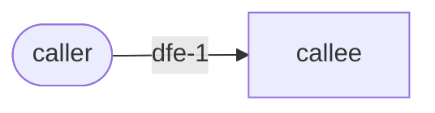

# [Spec Title] — Threat Model

## Narrative

[Who the attacker is, what they want, and which trust boundaries matter. Prose, not a table.]

## Elements

| id | Element | Boundary | Threats | Mitigations (REQ) |
|---|---|---|---|---|
| dfe-1 | [name] | [trust boundary name] | [STRIDE letters and one line each] | [what stops it, citing the REQ] |

## Data-flow diagram

## Domain checklist (REQ-333)

Every row below is answered, one of two ways:
- one or more ids from the frontmatter `dataflow_elements` that carry the risk (`dfe-1, dfe-2: ...`);
- `N/A because ` followed by the reason (at least 10 characters) the domain does not apply here.

`check-architecture.sh` fails the ARCHITECTURE exit gate on any row left blank, answered with a
bare `N/A`, or citing an element id that is not in the frontmatter.

| Domain | Answer |
|---|---|
| Authentication | dfe-1: [how identity is established, or N/A because ...] |
| Authorization | dfe-1: [who may do what, or N/A because ...] |
| Session | dfe-1: [how sessions are held, or N/A because ...] |
| PII and retention | N/A because [no personal data is stored/processed here] |
| Payments | N/A because [nothing here handles money] |
| Secrets at rest | dfe-1: [what secrets exist and where, or N/A because ...] |
| Sensitive logging | dfe-1: [what must never be logged, or N/A because ...] |
| Rate limiting | N/A because [no endpoint is exposed here] |
| Third-party integrations | dfe-1: [what is called out, or N/A because ...] |
| Update channel for apps | N/A because [this is not a distributed app] |

## Residual risks
- [What remains open even with every mitigation above in place.]
